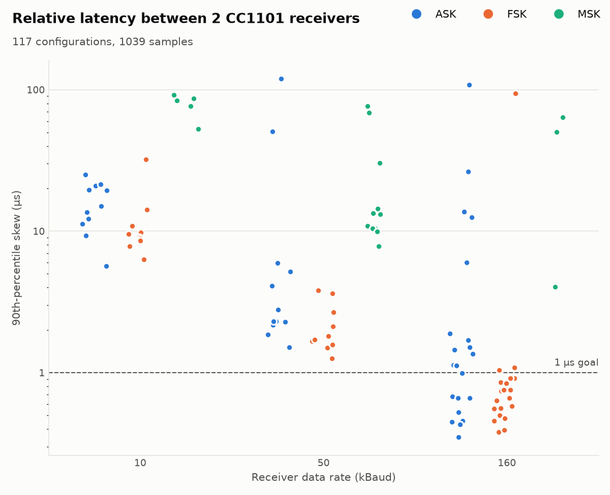
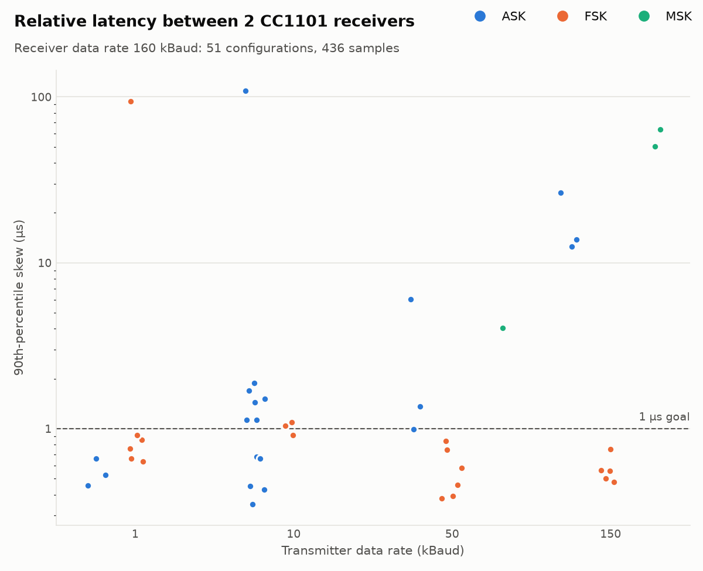
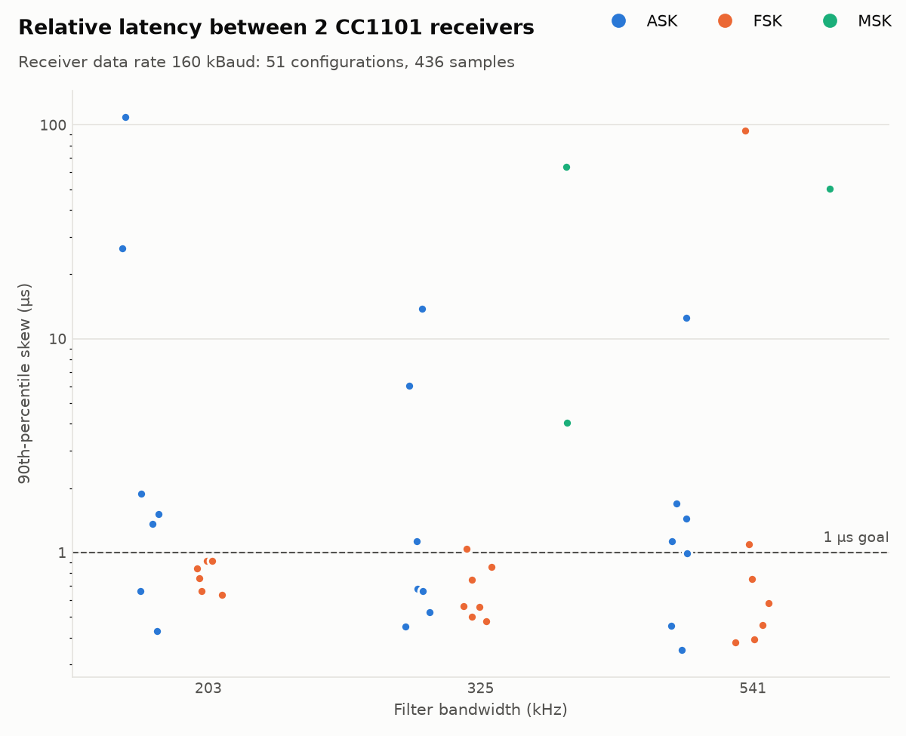
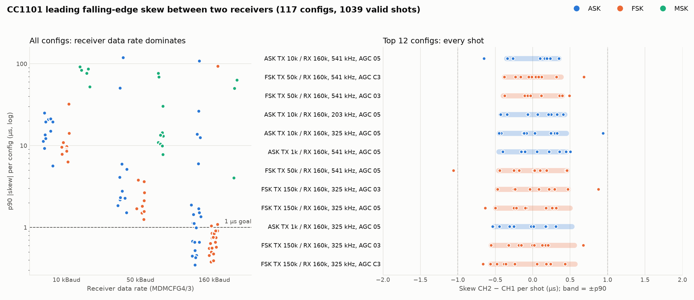

# CC1101 skew sweep: summary (2026-10-25)

Short overview of the automated sweep. The full method, per-config tables and setup notes are in
[`cc1101_sync_trigger.md`](cc1101_sync_trigger.md#skew-sweep-2026-10-25).

## Goal
Find CC1101 settings that **reliably** trigger two receivers within **1 µs** of each other. The
measure is the skew between the **first falling edge** of the two receivers' GDO2 data outputs for one
burst from the transmitter. "Reliably" means ranking by the 90th-percentile |skew| over 10 valid shots,
not by the median: a trigger has to be good on its bad shots too.

## Setup
- **Transmitter:** an ESP32 + CC1101 running `cc1101_sync_trigger_test/transmitter`, on `/dev/ttyUSB1`.
  - Its console menu sets the local data rate (`2`) and registers (`4`).
  - Menu `3` broadcasts register writes to the receivers over ESP-NOW, and `5` collects their
    register dumps for verification.
  - SPACE sends a `0xAAAAAA` burst.
- **Receivers:** two ESP32 + CC1101 nodes in async RX. GDO2 goes to the scope, CH1 (B0:B2:1C:A8:AD:80)
  and CH2 (8C:94:DF:58:7D:60).
- **Scope:** Siglent SDS1052DL+ at 192.168.1.159 (VXI-11). It sampled at 20 ns/sample over a ±164 µs
  window, triggered on CH1 falling at 1.65 V.

## How it was automated
1. **Interactive bring-up through MCP servers.**
   - The **pyvisa MCP** server worked out the scope's legacy SCPI dialect: `C1:WF? DAT2` waveform
     scaling, `C1:TRSL`/`TRMD SINGLE`/`SAST?` triggering. The newer `:TRIG:EDG:*` syntax is ignored by
     this model.
   - The **serial MCP** server drove the transmitter's menu by hand.
   - Together they took the first manual skew measurements (−1.8 to +7.7 µs at the default ASK settings).
2. **Unattended sweep in Python.** The validated sequences were moved into a host script, which ran for
   about 2 h. The MCP sessions were closed first, so the script could own the serial port and the scope.
   - `host/skew_sweep.py` drives the menu with pyserial and the scope with pyvisa.
   - `host/skew.py` extracts the interpolated first-falling-edge times. This keeps raw waveforms out of
     the conversation.
   - I checked the log periodically and fixed problems as they appeared: menu desyncs, scope noise
     triggers, and a transmitter firmware bug.
3. **Per config:**
   - Set the transmitter's data rate and registers.
   - Broadcast the receiver registers, then verify both receivers' dumps and re-broadcast any lost
     writes.
   - Take shots until there are 10 valid ones. A shot is valid only if both receivers start the
     capture in the same logic state.
   - Every row is logged to `readouts/skew_sweep_20261025.csv` (local only).

## Parameters swept
| Axis | Values |
|---|---|
| Modulation (MDMCFG2) | ASK/OOK 0x30, 2-FSK 0x00, MSK 0x70 |
| TX bit rate | 1, 10, 50, 150 kBaud (MSK ≥ 50 only) |
| RX data rate (receiver DRATE) | 10, 50, 160 kBaud |
| RX filter bandwidth (MDMCFG4[7:4]) | 203, 325, 541 kHz |
| AGC (AGCCTRL2/1/0) | 05/00/91, 03/00/91 (DN022), C3/00/91 (low gain), 03/40/91 (chip default) |

- **Stage 1:** all modulation × rate × bandwidth combinations, with AGC fixed at 05/00/91.
- **Stage 2:** the three best stage-1 configs per modulation, repeated with each of the other AGC
  presets.
- **Totals:** 117 configs, 1403 shots, 1039 valid.

## Results

The 90th-percentile skew of each of the 117 configs, grouped by receiver data rate (log scale, dashed
line = 1 µs goal). Regenerate with `host/plot_skew.py <csv> <png> --p90-only`.

Only the 51 configs at RX 160 kBaud, grouped by transmitter data rate. FSK stays at or under about
1 µs at every TX rate. ASK is best at 1–10 kBaud and gets worse at 50 and 150 kBaud. MSK runs only at
≥ 26 kBaud. The points near 100 µs are stage-2 AGC variants (ASK with 03/40/91, FSK with 03/00/91).
Regenerate with `--p90-only --rx 160 --by tx`.

The same configs, grouped by RX filter bandwidth. The best configs reach about 0.35–0.45 µs at all
three bandwidths, so the filter is secondary at this RX rate. Regenerate with
`--p90-only --rx 160 --by bw`.

Left: p90 |skew| of every config, grouped by receiver data rate (log scale). Right: every shot of the
12 best-ranked configs, with a band at ±p90. Regenerate with `host/plot_skew.py`.

- **The receiver data rate dominates.** At RX 160 kBaud, 26 of 51 configs had p90 < 1 µs. At 10 or
  50 kBaud, none did: typically 2–15 µs. The demodulator's sampling follows DRATE even in async mode.
- **ASK + AGC 05/00/91 is the most consistent.** It stays under 1 µs max at every filter bandwidth.
  - **Best:** ASK, TX 10 kBaud, RX 160 kBaud, 541 kHz, AGC 05/00/91. Over 10 shots this gave a p90 of
    **0.35 µs** and a max of 0.65 µs.
  - **Previous best:** ASK, TX 1k, RX 160k, 325 kHz. Confirmed at p90 0.53 µs.
- **FSK** is about as tight at its best (p90 0.38–0.39 µs) and is insensitive to AGC. But some FSK
  configs had occasional whole-bit outliers of 15–163 µs.
- **MSK is not usable in async mode.** Its best p90 was 4 µs, and many shots had the two receivers in
  different states before the burst.
- **Filter bandwidth and TX bit rate are secondary** at RX 160k. TX at 1–10 kBaud is best; 150 kBaud
  is worse.
- **Recommended config:**
  - ASK (MDMCFG2 = 0x30), transmitter at 10 kBaud.
  - Receivers: MDMCFG4 = 0x2C (541 kHz) or 0x8C (203 kHz), MDMCFG3 = 0x93, AGCCTRL2/1/0 = 05/00/91.
  - Sub-microsecond skew is achieved, but each config has only 10 shots, so a longer confirmation run
    is still needed (see `TODO.md`).

## Confirmation run (2026-10-26): 100 shots per config
The shortlist in `src/apps/cc1101_sync_trigger_test/configs_to_test.md` was run with
`host/skew_sweep.py --shortlist` at 100 valid shots each, 601 shots in about 15 min. Data:
`readouts/skew_confirm_20261026.{csv,log}` and `_summary.txt` (local only).

| Config | Median | p90 \|skew\| | p99 \|skew\| | Max \|skew\| | Shots > 1 µs | Std |
|---|---|---|---|---|---|---|
| **FSK, TX 50k, RX 160k, 541 kHz, AGC C3/00/91** | −0.05 | 0.48 | 0.76 | **0.87** | **0** | 0.32 |
| FSK, TX 50k, RX 160k, 541 kHz, AGC 03/40/91 | −0.01 | 0.46 | 0.81 | 19.9 | 1 | 2.00 |
| ASK, TX 10k, RX 160k, 541 kHz, AGC 05/00/91 | −0.17 | 0.67 | 0.92 | 1.07 | 1 | 0.42 |
| ASK, TX 10k, RX 160k, 203 kHz, AGC 05/00/91 | −0.05 | 0.78 | 1.27 | 1.62 | 5 | 0.50 |
| FSK, TX 10k, RX 160k, 203 kHz, AGC 05/00/91 | −0.05 | 0.79 | 1.10 | 2.13 | 3 | 0.53 |
| FSK, TX 1k, RX 160k, 203 kHz, AGC 05/00/91 | −0.04 | 0.82 | 1.31 | 1.35 | 5 | 0.49 |

- **The 10-shot p90s were optimistic.** With 100 shots, every config's p90 rose by about 0.1–0.3 µs
  (e.g. ASK 541 kHz went from 0.35 to 0.67 µs).
- **FSK, TX 50 kBaud, 541 kHz, AGC C3/00/91 is the only config with every shot under 1 µs** (max
  0.87 µs). One shot started in the wrong state (`invalid_prestate`) and was discarded.
- **The same FSK config with AGC 03/40/91 had one whole-bit outlier (19.9 µs, one bit at 50 kBaud).**
  Its p90 looks best, but one late bit in 100 rules it out as a trigger.
- **541 kHz beats 203 kHz** for both ASK and FSK: the 203 kHz configs have 3–5 shots over 1 µs.
- **ASK at 541 kHz is the runner-up** (one shot at 1.07 µs) and had no outliers.
- All six configs had a median within ±0.2 µs of zero, so neither receiver is consistently earlier.
