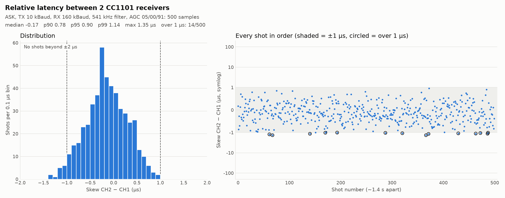
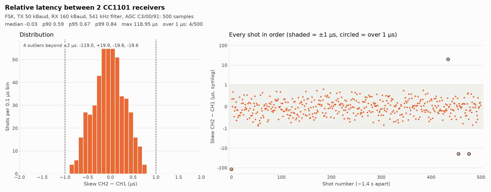

# CC1101 skew: 500-shot run (2026-10-26)

This run took the two best configs from `results_100shot_20261026.md` and ran 500 valid shots of each:
`host/skew_sweep.py --shortlist --only 2,1 --shots 500 --port /dev/ttyUSB0 --csv ../readouts/skew_confirm500_20261026.csv`.
- **Time:** about 23 min.
- **Shots:** no rejected shots; every shot was valid.
- **Data:** `readouts/skew_confirm500_20261026.{csv,log}` and `_summary.txt` (local only).

**Method:**
- **Skew** is CH2 − CH1 at the first falling edge, in µs.
- **Receivers:** 160 kBaud (MDMCFG4 0x2C, MDMCFG3 0x93).
- **Restore:** all nodes were put back to ASK, TX 1k, RX 160k, 325 kHz, AGC 05/00/91 afterwards.

## Results

| Config | Median | p90 \|skew\| | p95 | p99 | Max \|skew\| | Shots > 1 µs | Whole-bit outliers | Std |
|---|---|---|---|---|---|---|---|---|
| FSK, TX 50k, 541 kHz, AGC C3/00/91 | −0.03 | 0.59 | 0.67 | 0.84 | 119 | 4 (0.8%) | 4 | 5.54 (0.35 without outliers) |
| ASK, TX 10k, 541 kHz, AGC 05/00/91 | −0.17 | 0.78 | 0.90 | 1.14 | **1.36** | 14 (2.8%) | **0** | 0.44 |

The register sets are in `common/cc_link/cc_cfg_ask_10k.c` and `cc_cfg_fsk_50k.c`. Regenerate the plots
with `host/plot_skew.py <csv> <png> --config <config ID>`.

### FSK C3 outliers
- **Shot 0: −119 µs.** CH2 fell 119 µs *before* CH1. This was the first shot after the registers were
  reconfigured, so it was most likely a stray edge while that receiver settled. It may be a setup
  artifact, but a real trigger would see the same thing after any reconfiguration.
- **Shots 434, 455 and 476: +19.9, −19.6 and −19.6 µs.** Each is exactly one bit at 50 kBaud, in
  both directions. They are evenly spaced, 21 shots (about 29 s) apart, and all late in the run, which
  suggests periodic interference or drift rather than random noise.
- **Without the outliers:** the other 496 shots have a max of 0.87 µs and a std of 0.35 µs.

### ASK at 541 kHz
- **Bounded error:** no whole-bit outliers. The worst shot is 1.36 µs.
- **All 14 misses over 1 µs are negative** (CH2 early, −1.01 to −1.35 µs). They are spread evenly
  across the run.
- **Constant offset:** the median is −0.17 µs, which looks like a fixed offset between these two
  receivers. With it subtracted, the worst shot is about 1.19 µs from the median.

## Findings
- **With 500 shots, neither config keeps every shot under 1 µs.**
- **FSK C3 is tighter most of the time but fails badly about 0.8% of the time** (one or more whole
  bits, up to 119 µs). For a trigger, a rare error of tens of µs is worse than a consistent 1.4 µs
  worst case.
- **ASK, TX 10k, 541 kHz, AGC 05/00/91 has the better worst case:** about 0.9 µs p95, a bounded
  1.36 µs max, and no whole-bit errors in 500 shots. This is the recommended config to bake into
  `cc_ask.c` unless the FSK outliers can be explained and removed.
- **The 100-shot results understated the tails.** FSK C3 looked clean at 100 shots (max 0.87 µs), and
  ASK's max rose from 1.07 to 1.36 µs.

## Next
- **Look into the FSK one-bit outliers.** Check whether the ~29 s spacing lines up with something
  (ESP-NOW/Wi-Fi beacons, another 433 MHz source, AGC freeze/recovery).
- **ASK's constant −0.17 µs offset** could be a hardware difference (crystal, trace length) that can
  be calibrated out per receiver. Check it by swapping the scope channels or the receivers.
- **Try a higher RX data rate** (> 160 kBaud) with ASK to tighten the tail further.
